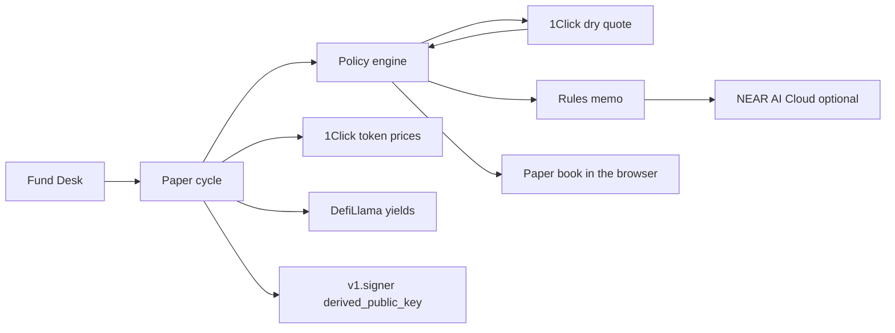
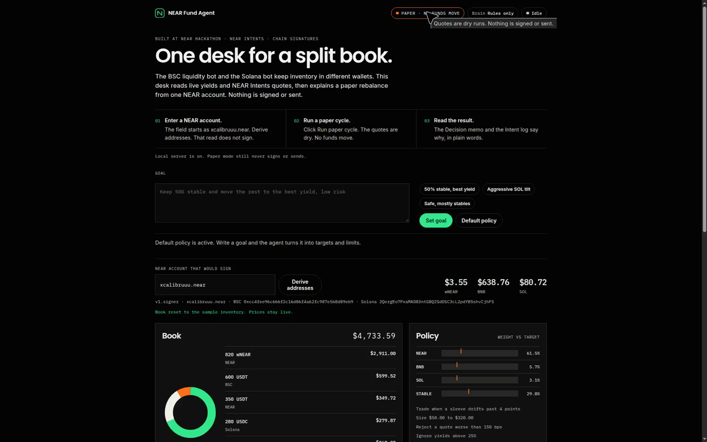
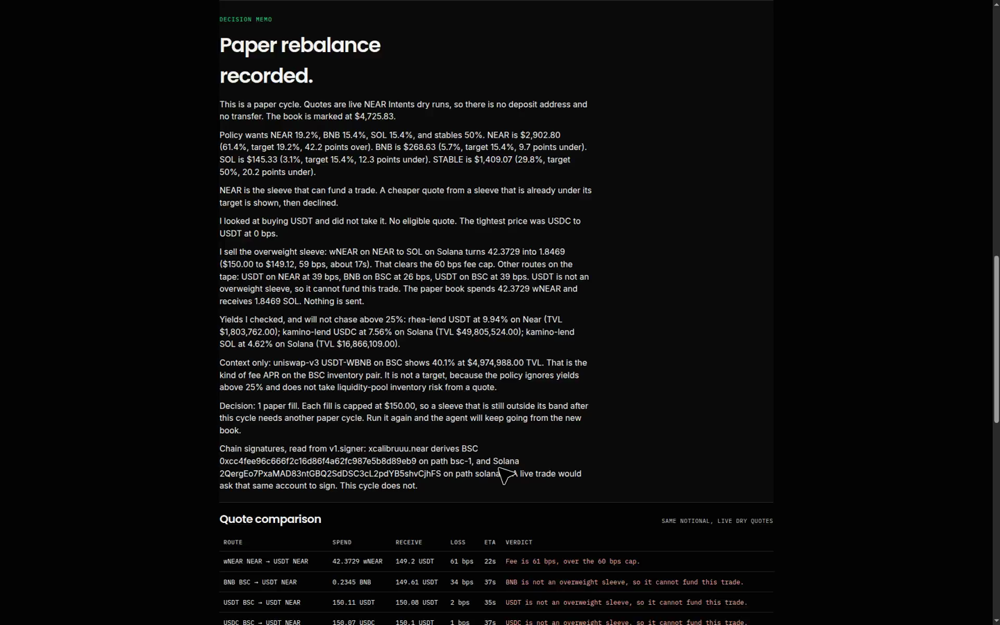
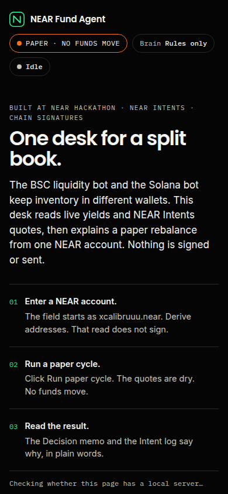

# NEAR Fund Agent

A paper fund desk for someone who already runs inventory on more than one chain. Tell it a goal in plain words ("keep 50% stable, rest to the best yield, low risk") and it turns that into policy, then rebalances on its own in auto-pilot. It marks a NEAR, BSC, and Solana book with live prices, asks NEAR Intents for real dry quotes, and writes the rebalance decision in plain words. One NEAR account is the signer. Chain signatures show the BSC and Solana addresses that account would control. The default mode never moves money.

Built at [NEAR HACKATHON](https://nearhackathon.com/) (Build Beyond Boundaries), 1 to 14 Nov 2026. Tracks this is aimed at: `defi` and `agents`.

Visual direction follows [Oravo](https://www.framer.com/marketplace/templates/oravo/), a free Framer template by Creative Dima (listed as Free, remix for free). Type, spacing, and the dark palette only. No template assets, images, or code were copied.

## Verify this

A reviewer can do the following and see the result named on the right.

1. `npm install` then `npm test`. The policy tests pass with no network.
2. `npm start`, then open http://localhost:8787.
3. Leave the account as `xcalibruuu.near`, or type your own NEAR account. Click **Derive addresses**. The desk reads `v1.signer` and shows a BSC address and a Solana address. That call does not sign.
4. Click **Run paper cycle**.
5. You should see live USD values, a chain chart, a yield strip (Rhea, Kamino, and a BSC pool marked context), a quote table with a loss in bps, and a memo that names the route it took and the cheaper routes it declined. The book amounts change. The stamp stays **Paper**. There is no wallet popup and no deposit address.
6. Click **Reset book** to restore the sample inventory.

`npm run cycle` prints the same memo in the terminal.

The static desk also runs without this server. `npm run build` writes `public/app.js`. Opening that folder on GitHub Pages calls 1Click, DefiLlama, and NEAR RPC from the browser. The hosted URL after the Pages workflow runs on `main` is https://xcalibruuu.github.io/near-fund-agent/ .

## Goal and auto-pilot

- **Goal box.** The text becomes targets and limits. With `NEAR_AI_API_KEY` set, NEAR AI Cloud reads the goal and returns JSON. Without a key, a rules parser reads shares like `50% stable` and words like `low risk` or `best yield`. See `src/goal.ts`.
- **A model can only tighten.** Whatever the model returns is validated and clamped. Trade size and the quote loss cap can go down, never above the defaults. Targets must fit in 100%. If the model fails or answers badly, the rules parser takes over.
- **Auto-pilot.** The desk runs a paper cycle every 20 s, 45 s, 90 s or 5 min, up to 12 times, and tags each log entry `auto-pilot` or `manual`. It still moves no funds.

## The problem

A small operator can have a BSC liquidity bot (WBNB/USDT) and a Solana trading bot and still have no single place that says what the book is worth, or why it should move. Each chain has its own wallet, its own gas token, and its own bridge tab. The decision is a spreadsheet. The transfer is a second product.

NEAR Fund Agent treats that inventory as one USD policy:

| Sleeve | Target |
| --- | --- |
| NEAR | 25% |
| BNB | 20% |
| SOL | 20% |
| Stables | 35% |

The sample book is deliberately drifted. wNEAR is about 60% of the book. BNB and SOL inventory are thin. The first cycle sells wNEAR into SOL and BNB, capped at $320 a fill, and says so.

This repository is new for the hackathon. It does not contain the BSC bot or the Solana bot. Those stay where they are. Only the NEAR control layer is here. The paper balances are shaped like that inventory. They are not read from those wallets.

## What is real, and what is simulated

| Piece | Real or simulated |
| --- | --- |
| Token prices | Real. `GET https://1click.chaindefuser.com/v0/tokens` |
| Swap quotes | Real dry quotes. `POST /v0/quote` with `dry: true`. No deposit address is requested, and a deposit address is discarded if one appears |
| Yields | Real. DefiLlama pool list, filtered. Rhea USDT lend, Kamino USDC, Kamino SOL. Pools above 25% APY or flagged as outliers are not targets |
| BSC WBNB/USDT fee APR | Real context row only. The policy does not chase it |
| Chain-signature addresses | Real view call. `v1.signer.derived_public_key` on mainnet for paths `bsc-1` (secp256k1, domain 0) and `solana-1` (ed25519, domain 1). The EVM address is keccak256 of the uncompressed key. The Solana address is the ed25519 public key |
| Portfolio balances | Simulated. Stored in the browser. Reset restores the sample |
| Fills | Simulated. The paper book applies `amountIn` and `amountOut` from the winning dry quote |
| Signing and transfers | Not implemented in the demo path. `sign` is never called. No transaction is broadcast |
| NEAR AI Cloud | Optional. If `NEAR_AI_API_KEY` is set, the model may rewrite the memo. The policy has already decided. With no key, the memo is the rules engine |

WBNB is not a separate 1Click asset. The BSC sleeve is marked as BNB, which is the token Intents quotes, and treated 1:1 with wrapped BNB for this book.

## Chains

The source of truth is the live list `GET https://1click.chaindefuser.com/v0/tokens`. Each token has a `blockchain` field. The registry in `src/chains.ts` is one entry per chain we have looked at: id, family (`evm`, `svm`, `near`, or `other`), chain-signature path when we have one, 1Click asset ids, and an explorer template. Checked 13 Nov 2026. The paper book and the demo stay on three chains.

### Tested now

NEAR, BSC, and Solana. Goals, auto-pilot, and the screen recording use only these. Chain signatures are read for BSC (`bsc-1`, secp256k1, domain 0) and Solana (`solana-1`, ed25519, domain 1).

### Add with one registry entry

These EVM chains are already on that live list, and a dry quote from 20 wNEAR into the chain's ETH asset returned a price. They are in the registry with `demo: false`. The same secp256k1 domain used for BSC applies. A different path is a different address (`eth-1`, `base-1`, `arb-1`, `op-1`). This repo has not called `v1.signer.sign` for any of them. Turning one on in the paper book is a position plus `demo: true`, not a new integration.

| Chain | `blockchain` | Dry quote checked |
| --- | --- | --- |
| Ethereum | `eth` | wNEAR to ETH, priced. The list had 29 Ethereum assets. |
| Base | `base` | wNEAR to ETH, priced. Base USDC as the origin returned an internal error, so that direction is not checked. The list had 18 Base assets. |
| Arbitrum | `arb` | wNEAR to ETH, priced. The list had 7 Arbitrum assets. |
| Optimism | `op` | wNEAR to the listed ETH id, priced. ETH, WETH, and USDC on Optimism use the older `nep245` ids, not the `nep141` form used on Ethereum, Base, and Arbitrum. The list had 6 Optimism assets. |

Also on the same list, and not given a registry row here because no dry quote was run: `pol`, `avax`, `gnosis`, `scroll`, and others. Read the endpoint. Do not treat this table as the full catalog.

### Routable, not a trading integration

Hyperliquid is `blockchain: "hypercore"`. The list has three assets and no HYPE token:

- USDC `1cs_v1:hypercore:hip1:0x6d1e7cde53ba9467b783cb7c530ce054` (8 decimals)
- USDC `1cs_v1:hypercore:erc20:0xb88339CB7199b77E23DB6E890353E22632Ba630f` (6 decimals)
- wNEAR `1cs_v1:hypercore:hip1:0x20b8c9d2f022ffd2aea4f7962b7b1d8b` (8 decimals)

Dry quotes from wNEAR on NEAR returned a price the same day: about 70.5 USDC for 20 wNEAR on both USDC ids, and about 14.99 Hyperliquid wNEAR for 15 wNEAR. The erc20 USDC id was rejected as an origin ("not supported as origin asset"). No chain-signature path for Hyperliquid orders is in this repo. Routable via NEAR Intents for USDC and wNEAR. Not a trading integration, and not in the demo.

Pearl is `blockchain: "prl"`. Native PRL is `nep141:prl.omft.near` (8 decimals). PRL on NEAR is `1cs_v1:near:nep141:prl.omft.near`. A NEAR account was rejected as a Pearl recipient. With a `prl1p` recipient, dry quotes from NEAR USDT, NEAR USDC, and wNEAR into PRL, and from PRL back to NEAR USDT, all came back "No liquidity available". Pearl is on the token list. It is not a verified priced route, so it is not called routable here, and it is not in the demo.

A chain is supported in this desk only after all three of these, and only the first two are true for Hyperliquid:

1. A row on the live token list.
2. A dry quote that returns an amount out, not an error or "No liquidity available".
3. A chain-signature domain and path read from `v1.signer`, and an address encoding this repo has tested.

## How NEAR fits

**NEAR Intents.** The agent does not pick a bridge. For each underweight sleeve it asks 1Click for the same USD notional from every holding that can fund it. The quote returns amount in, amount out, USD value, and an estimated time. Paper mode always sends `dry: true`, so the response is a price, not a deposit address. See `src/intents.ts` and `src/clients.ts`.

**Chain signatures.** A NEAR account is the only signer. The desk derives the BSC address (same secp256k1 key every EVM chain would use for that path) and the Solana address. A live trade would ask that account to call `v1.signer.sign`. This demo only reads `derived_public_key`. The quote recipient is that derived address when derivation succeeds.

**Chain abstraction.** The policy is in USD weights. The operator does not choose a source chain, a bridge, or a gas token. The agent ranks routes NEAR Intents already priced, then refuses a cheap route when spending it would pull a sleeve further under its target. In the sample book, USDT to SOL is often cheaper than wNEAR to SOL. The memo shows that price and declines it, because stables are already under 35%.

**NEAR AI Cloud.** Optional rewrite through the OpenAI-compatible gateway at `https://cloud-api.near.ai/v1`. The key stays in the environment. The browser never sees it. Without a key, the desk still explains every number from the rules.

## Policy

The rules live in `src/policy.ts` and are what the tests lock in.

- Trade only when a sleeve is more than 4 percentage points off target.
- One fill is between $50 and $320. A sleeve that is still off after that needs another cycle.
- Reject a quote that loses more than 150 bps of USD value.
- A source can fund an allocation trade only when its sleeve is overweight. A cheaper quote from an underweight sleeve is shown, then declined.
- Ignore lend and stake yields above 25%, outlier flags, and pools under $1M TVL.
- If the book is inside the bands, a stable may move to a better venue only when the yield gap earns the quote cost back inside 45 days.
- Live quotes (`dry: false`) throw unless `FUND_AGENT_MODE=live` and `FUND_AGENT_CONFIRM_LIVE=yes`. Even then the server does not broadcast a transfer. It would only return a 1Click deposit address for a human to fund. The desk has no button for that.

## Architecture



```text
src/policy.ts        targets and limits
src/planner.ts       which sleeves to trade
src/decide.ts        accept, decline, paper fill
src/explain.ts       plain-language memo
src/intents.ts       dry quote builder
src/clients.ts       1Click, DefiLlama, NEAR RPC
src/address.ts       secp256k1 to EVM, ed25519 to Solana
src/cycle.ts         one paper cycle
src/server.ts        local desk and the live-quote gate
src/browser/main.ts  the dashboard
```

## Demo script

About a minute, which is also the shape of the screen recording.

1. Open the desk. Point at the Paper stamp and the three prices.
2. Show the donut and the policy bars. NEAR is far above the brass tick. SOL and BNB are short.
3. Show the yield cards, including the BSC pool tagged context.
4. Show the derived BSC and Solana addresses under the account field.
5. Click **Run paper cycle**. Wait for the quote table.
6. Read one chosen row (wNEAR to SOL or wNEAR to BNB) and one declined row (a stablecoin route with a smaller loss).
7. Read the first lines of the memo. The amounts on the book have changed. The stamp has not.

## Run it

Node 20 or newer.

```sh
npm install
npm start
```

Open http://localhost:8787.

```sh
npm test
npm run typecheck
npm run cycle
```

Copy `.env.example` to `.env` only if you want an optional key. Do not commit `.env`.

```sh
# optional memo rewrite. The policy still decides.
NEAR_AI_API_KEY=
NEAR_AI_BASE_URL=https://cloud-api.near.ai/v1
NEAR_AI_MODEL=z-ai/glm-5.2

# optional partner JWT from https://partners.near-intents.org
# without it, 1Click adds a small unauthenticated fee
# ONECLICK_JWT=
```

Both of the next two lines are required before `POST /api/live-quote` will do anything, and that route still does not send funds. Leave them unset for the demo.

```sh
# FUND_AGENT_MODE=live
# FUND_AGENT_CONFIRM_LIVE=yes
```

## Screenshots

The desk before a cycle, marked with live prices:



After a paper cycle, with the quote table and the memo:



The same desk at a phone width. The three start steps stack:



## Tests and CI

`npm test` covers base-unit conversion, EVM and Solana address derivation, the drifted-book plan, the cheaper-but-ineligible quote, the fee cap, the yield-horizon check, the dry-quote gate, and the length of the X drafts in `DEMO_POST.md`.

GitHub Actions (`.github/workflows/ci.yml`) runs tests, `tsc`, and the browser bundle. `.github/workflows/pages.yml` publishes `public/` to GitHub Pages when it lands on `main`.

## Libraries

Runtime dependencies are `@noble/hashes` (keccak256), `@scure/base` (base58), `esbuild`, `tsx`, and `typescript`. Tests use Vitest. No pre-hackathon code of the author's is included. The initial commit on `main` was a title line.

## Demo recording

`GROK_DEMO_BRIEF.md` is the shot list and rules for recording the 90 second demo.

## Still for the human

The hackathon submission is a public repo plus a public X post. Drafts are in `DEMO_POST.md`. This agent does not post, and it does not send the application. The form needs the author's name, email, NEAR account, team size, and consent, and those are not guessed here. Submission notes are in [HACKATHON.md](https://nearhackathon.com/HACKATHON.md).

## License

MIT. See [LICENSE](LICENSE).
